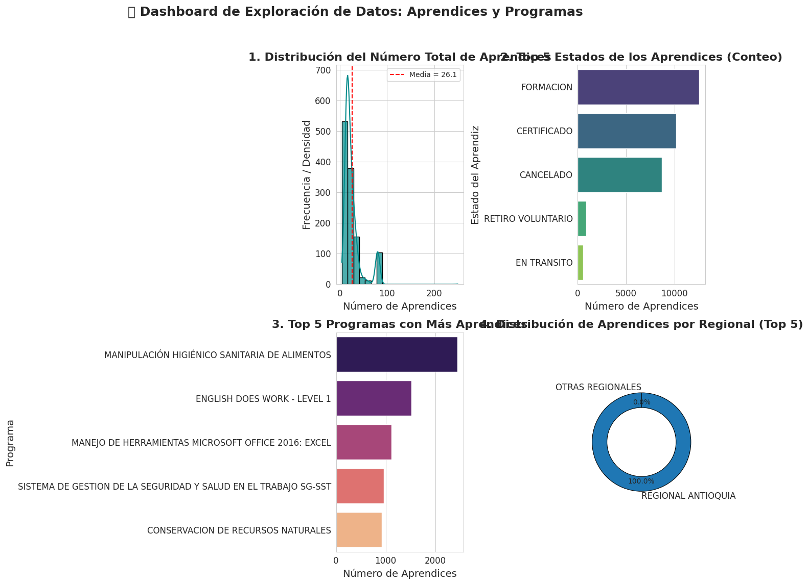
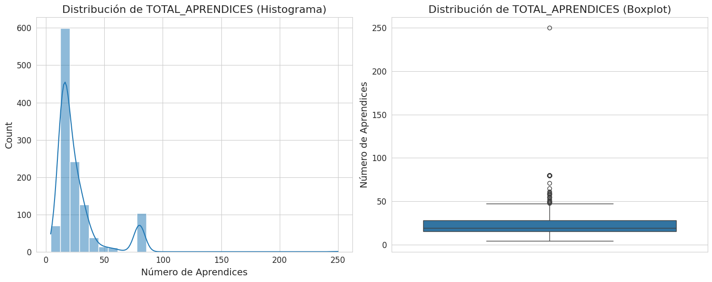

# Automated Academic Data Cleaner

[](https://colab.research.google.com/github/yeimy07/automated-academic-data-cleaner/blob/main/AnalisisData.ipynb)


Pipeline en Python para **limpiar, cruzar y analizar los reportes académicos del SENA** (PE-04 y DF-14), reemplazando el procesamiento manual en Excel que hacían los docentes y el área administrativa del **Centro de los Recursos Naturales Renovables La Salada** (Regional Antioquia).



## El problema

Cada periodo, el centro descarga dos reportes desde el aplicativo institucional:

| Reporte | Contenido | Archivo |
|---|---|---|
| **DF-14** | Aprendices matriculados (estado, programa, sede, convenio…) | `B1.xlsx` |
| **PE-04** | Programación de fichas (jornada, nivel, fechas, cupos por género…) | `B2.xlsx` |

Consolidarlos a mano implicaba horas de filtros, fórmulas y `BUSCARV`, con errores frecuentes por textos mal escritos, columnas vacías y fechas en formatos distintos.

**Pregunta guía:** ¿cómo puede un modelo automatizado de análisis de datos optimizar el procesamiento, la organización y la interpretación de esta información para apoyar la toma de decisiones institucionales?

## Qué hace el notebook

1. **Carga** los dos reportes de Excel (encabezado en la fila 5).
2. **Limpieza general:** elimina duplicados y normaliza los nombres de columna.
3. **Limpieza específica:**
   - Estandariza textos (mayúsculas, espacios) en sede, regional, programa, nivel y estado.
   - Rellena vacíos con reglas de negocio (`NO APLICA`, `SIN CONVENIO`, `NO`).
   - Convierte las fechas de inicio y fin de ficha a `datetime`.
4. **Cruce (left join)** de matriculados con programación por código de ficha → **33.259 registros × 74 columnas**.
5. **Estadística descriptiva:** media, mediana, moda, desviación, varianza, asimetría y curtosis del tamaño de las fichas.
6. **Visualizaciones:** distribución de aprendices, estados, programas con más matrícula, nivel vs. modalidad y eficiencia (formación vs. retiro voluntario).

## Resultados principales

| Variable | Media | Mediana | Desv. estándar | Asimetría | Curtosis |
|---|---:|---:|---:|---:|---:|
| Total de aprendices por ficha | 26,10 | 19,00 | 19,79 | 2,92 | 15,62 |
| Aprendices mujeres | 15,93 | 12,00 | 13,63 | 1,93 | 4,63 |
| Aprendices hombres | 9,73 | 8,00 | 9,37 | 3,28 | 27,46 |

- **Asimetría positiva fuerte:** la mayoría de las fichas son pequeñas, pero unas pocas fichas masivas (convenios, programas troncales) disparan el promedio.
- **La mediana (19) representa mejor la ficha típica** que la media (26).
- **Distribución leptocúrtica con muchos atípicos:** esas fichas grandes son las que más pesan en las metas de cobertura y conviene revisarlas por separado.
- **Retención:** entre los aprendices activos o retirados, cerca del 93 % sigue en formación.

<p align="center">
  
</p>

## Cómo ejecutarlo

### En Google Colab (recomendado)

1. Abre el notebook con el botón **Open in Colab**.
2. Ejecuta las celdas en orden; cuando lo pida, sube `B2.xlsx` (PE-04) y luego `B1.xlsx` (DF-14).

### En local

```bash
git clone https://github.com/yeimy07/automated-academic-data-cleaner.git
cd automated-academic-data-cleaner
pip install -r requirements.txt
jupyter notebook AnalisisData.ipynb
```

Copia `B1.xlsx` y `B2.xlsx` en la carpeta del proyecto y comenta las líneas de `files.upload()`, que solo funcionan en Colab.

> **Datos:** los reportes contienen información personal de aprendices, así que **no se incluyen en el repositorio**. El `.gitignore` excluye los archivos `.xlsx` para evitar subirlos por error.

## Estructura

```
automated-academic-data-cleaner/
├── AnalisisData.ipynb   # Pipeline completo: carga → limpieza → cruce → análisis
├── docs/img/            # Gráficas usadas en este README
├── requirements.txt
└── README.md
```

## Tecnologías

Python · pandas · NumPy · Matplotlib · Seaborn · statsmodels · scikit-learn · Google Colab

## Próximos pasos

- Extraer la limpieza a un módulo `.py` reutilizable y ejecutable por línea de comandos.
- Exportar automáticamente el consolidado limpio a Excel para el área administrativa.
- Programar la ejecución periódica con los reportes de cada corte.

## Autora

**Yeimy Alejandra Sánchez Gil**, ingeniera informática · Medellín, Colombia
[GitHub @yeimy07](https://github.com/yeimy07)
